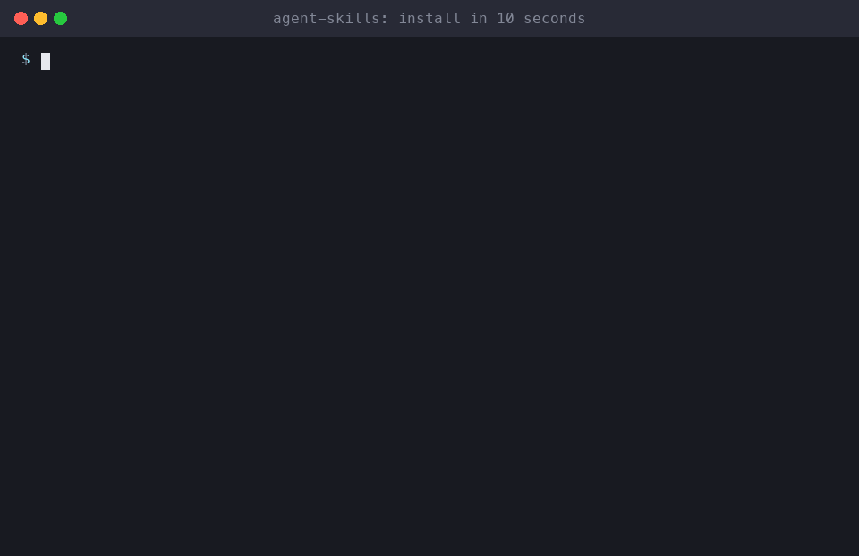
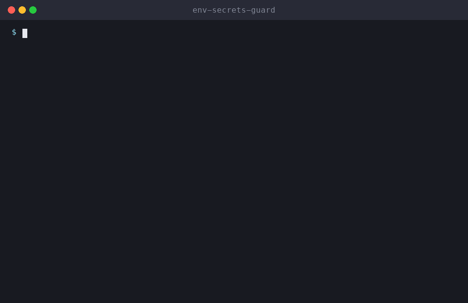
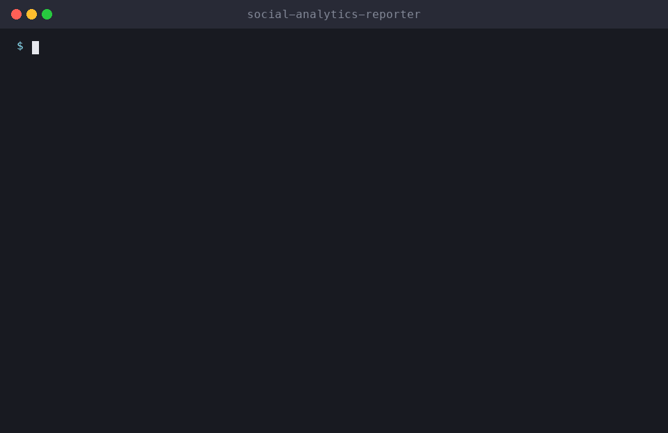

<div align="center">

# 🧰 Agent Skills

### Roast your GitHub with real data. Strip AI slop from your writing. Turn your git history into a documentary. Plus 48 more skills for developers and marketers.

**Works with Claude Code · Cline · Cursor · Codex · any agent that reads `SKILL.md`**

[](https://github.com/milad-ahmd/agent-skills)
[](LICENSE)

[](#-contributing)

[🌐 Website](https://milad-ahmd.github.io/agent-skills/) · [Start here](#-start-with-these-three) · [Install](#-install-in-10-seconds) · [Packs](#-packs-install-by-who-you-are) · [Platform agents](#-social-platform-agents) · [Marketing skills](#-marketing--content-skills) · [Developer skills](#-developer-skills) · [What is a skill?](#-what-is-a-skill) · [Awesome list](https://github.com/milad-ahmd/awesome-agent-skills)



</div>

---

## ⭐ Start with these three

Each one runs a real script first, so the agent works from facts about *your* profile, text or repo instead of guessing.

### 🔥 [roast-my-github](skills/roast-my-github)
Pulls your public GitHub stats, roasts the habits (never the person), then gives you a scorecard and a five-step glow-up plan.
Try: *"Roast my GitHub: your-username"*


### 🧹 [ai-slop-detector](skills/ai-slop-detector)
Scores text for AI-sounding phrases and patterns, shows where they are, and rewrites them to sound human while keeping your voice.
Try: *"De-slop this blog post"*


### ⏳ [codebase-time-machine](skills/codebase-time-machine)
Reads your git history and tells the story of the repo as a documentary: its eras, cast, plot twists and cursed files.
Try: *"Tell me the story of this codebase"*


---

## ⚡ Install in 10 seconds

### Option 1: Claude Code plugin (recommended)

```text
/plugin install all-skills --marketplace milad-ahmd/agent-skills
```

Or install just one pack:

```text
/plugin install creator-pack --marketplace milad-ahmd/agent-skills
/plugin install marketer-pack --marketplace milad-ahmd/agent-skills
/plugin install indie-hacker-pack --marketplace milad-ahmd/agent-skills
/plugin install local-business-pack --marketplace milad-ahmd/agent-skills
/plugin install startup-cto-pack --marketplace milad-ahmd/agent-skills
/plugin install developer-pack --marketplace milad-ahmd/agent-skills
/plugin install skill-builder-pack --marketplace milad-ahmd/agent-skills
/plugin install fun-pack --marketplace milad-ahmd/agent-skills
```

On older Claude Code versions, run `/plugin marketplace add milad-ahmd/agent-skills` first.

### Option 2: `npx skills` (Cursor, Codex, Cline, Windsurf, Copilot and 75+ agents)

```bash
npx skills add milad-ahmd/agent-skills                          # pick skills interactively
npx skills add milad-ahmd/agent-skills --skill roast-my-github  # one skill
```

### Option 3: shell installer

```bash
# all 51 skills
curl -fsSL https://raw.githubusercontent.com/milad-ahmd/agent-skills/main/install.sh | bash

# or a role-based pack
curl -fsSL https://raw.githubusercontent.com/milad-ahmd/agent-skills/main/install.sh | bash -s -- --pack creator

# or only the ones you want
curl -fsSL https://raw.githubusercontent.com/milad-ahmd/agent-skills/main/install.sh | bash -s -- pr-reviewer-pro env-secrets-guard

# project-local install (commit it so your whole team gets the skills)
curl -fsSL https://raw.githubusercontent.com/milad-ahmd/agent-skills/main/install.sh | SKILLS_DIR=.claude/skills bash
```

Then just talk to your agent normally. It picks the right skill automatically.

### 🎒 Packs: install by who you are

| Pack | For | Includes |
|---|---|---|
| `indie-hacker` | Solo founders | idea validation, landing page roast, launch posts, ASO, SEO, X & Reddit |
| `creator` | Creators & influencers | Instagram, TikTok, YouTube, repurposing, hooks, calendar, analytics |
| `marketer` | Marketing teams | brand voice, ads, email, SEO, competitors, influencers, analytics |
| `local-business` | Shops, clinics, restaurants | Google Business Profile, WhatsApp, Facebook, Instagram |
| `startup-cto` | Engineering leads | PR review, incidents, cost cutting, secrets, deps, migrations |
| `developer` | Every dev | the 12 core dev workflow skills |
| `skill-builder` | Skill authors | skill-creator-pro, skills-doctor, agent-memory-keeper |
| `fun` | Everyone | roast-my-github, codebase-time-machine, landing-page-roaster, ai-slop-detector |

Run `install.sh --list` to see every skill and pack.

## 🎬 More demos (real output, not mockups)

| 🔐 env-secrets-guard | 🩺 skills-doctor |
|---|---|
|  |  |

## 📚 All 51 skills

⚙️ = ships a script that collects real data (git history, API results, files) before the agent writes anything.

## 🎉 Fun & Viral

| Skill | What it does | Try saying |
|---|---|---|
| 🔥 [**roast-my-github**](skills/roast-my-github) ⚙️ | Get your GitHub profile roasted with real data, then a scorecard and glow-up plan | *"Roast my GitHub: milad-ahmd"* |
| 🦈 [**startup-idea-validator**](skills/startup-idea-validator) | Stress-test a startup idea with a VC, customer and competitor panel, cheap experiments and a verdict | *"Validate my startup idea: ..."* |
| ⏳ [**codebase-time-machine**](skills/codebase-time-machine) ⚙️ | The story of your repo from git history, as a documentary: eras, cast, plot twists, cursed files | *"Tell me the story of this codebase"* |
| 🧹 [**ai-slop-detector**](skills/ai-slop-detector) ⚙️ | Score text for AI-sounding writing and rewrite it to sound human, keeping the author's voice | *"De-slop this blog post"* |

## 🦸 Agent Superpowers

| Skill | What it does | Try saying |
|---|---|---|
| 🧠 [**agent-memory-keeper**](skills/agent-memory-keeper) | Persistent project memory (MEMORY.md) so your agent stops repeating the same mistakes | *"Remember that we use pnpm, not npm"* |
| 🛠️ [**skill-creator-pro**](skills/skill-creator-pro) ⚙️ | Turn any workflow into a well-written SKILL.md, with a linter to validate it | *"Create a skill for our release process"* |
| 🩺 [**skills-doctor**](skills/skills-doctor) ⚙️ | Audit your installed skills for broken frontmatter, vague triggers, conflicts and leaked secrets | *"Check my installed skills"* |

## 🛠️ Ops & Growth

| Skill | What it does | Try saying |
|---|---|---|
| 💸 [**cost-cutter**](skills/cost-cutter) | Cut cloud, SaaS and LLM API bills with dollar estimates, effort, risk and exact fixes | *"Why is our AWS bill so high?"* |
| 🚨 [**incident-commander**](skills/incident-commander) | Run a production outage from triage to mitigation, status updates and a blameless postmortem | *"Production is down, help me"* |
| 📱 [**app-store-optimizer**](skills/app-store-optimizer) | App Store and Google Play ASO: keywords, titles, screenshot captions, review replies, A/B tests | *"Optimize my App Store listing"* |

## 🤖 Social Platform Agents

One complete agent skill per platform. Each one handles profile setup, content, engagement and analytics for its platform. Start with **social-media-manager**, which decides which platforms you need and coordinates the rest.

| Skill | What it does | Try saying |
|---|---|---|
| 🧠 [**social-media-manager**](skills/social-media-manager) | All-in-one social media manager: picks platforms, sets KPIs, plans weekly and directs every platform skill | *"Manage my brand's social media"* |
| 💼 [**linkedin-growth-manager**](skills/linkedin-growth-manager) | LinkedIn profile rewrite, post writing, comment strategy and analytics for personal brands and company pages | *"Rewrite my LinkedIn headline and About"* |
| 𝕏 [**x-twitter-growth-manager**](skills/x-twitter-growth-manager) | Grow on X/Twitter with profile, daily posts, threads, a reply strategy and analytics | *"Write a thread about what I learned building X"* |
| 👍 [**facebook-page-manager**](skills/facebook-page-manager) | Facebook Pages and Groups: setup, posts, Reels, Messenger replies, reviews and boosting | *"Set up and plan content for my Facebook page"* |
| 📌 [**pinterest-growth-manager**](skills/pinterest-growth-manager) | Pinterest SEO: keywords, boards, Pin titles and descriptions, and seasonal plans for traffic | *"Create a Pinterest strategy for my blog"* |
| 🧵 [**threads-growth-manager**](skills/threads-growth-manager) | Grow on Meta Threads with conversation-starting posts, reply strategy and a content bank | *"Write 20 Threads posts for my brand"* |
| 👽 [**reddit-marketing-agent**](skills/reddit-marketing-agent) | Authentic Reddit marketing: subreddit research and rules, value-first posts and launch posts | *"Find subreddits where I can share my app"* |
| ✈️ [**telegram-channel-manager**](skills/telegram-channel-manager) | Grow and run a Telegram channel or group: content, formatting, moderation and monetization | *"Plan a content calendar for my Telegram channel"* |
| 💬 [**whatsapp-business-agent**](skills/whatsapp-business-agent) | WhatsApp Business for sales and support: quick replies, broadcasts, API templates and chatbot flows | *"Set up WhatsApp Business replies for my shop"* |
| 📍 [**google-business-profile-manager**](skills/google-business-profile-manager) | Rank on Google Maps: Google Business Profile optimization, posts, reviews and local SEO | *"Optimize my Google Business Profile"* |

## 📣 Marketing & Content Skills

Your AI agent can also act as a social media manager, content strategist and growth marketer.

| Skill | What it does | Try saying |
|---|---|---|
| 📸 [**instagram-growth-manager**](skills/instagram-growth-manager) | Grow and manage Instagram with bio audits, Reels scripts, carousels, captions, hashtags and growth reviews | *"Audit my Instagram profile and plan next month"* |
| 🎵 [**tiktok-viral-creator**](skills/tiktok-viral-creator) | TikTok ideas, 2-second hooks, shot-by-shot scripts and retention analysis | *"Give me 10 TikTok ideas for my fitness app"* |
| 📺 [**youtube-seo-optimizer**](skills/youtube-seo-optimizer) | YouTube titles, thumbnails, descriptions, chapters and channel audits for more views | *"Optimize the title and description for this video"* |
| 🎬 [**youtube-script-writer**](skills/youtube-script-writer) | High-retention YouTube and Shorts scripts with hooks, open loops and B-roll cues | *"Write a 10-minute YouTube script about X"* |
| ♻️ [**content-repurposer**](skills/content-repurposer) | One video or podcast into 15+ posts: Shorts, Reels, threads, LinkedIn, carousel, newsletter | *"Repurpose this transcript into social posts"* |
| 🗓️ [**social-media-calendar**](skills/social-media-calendar) | Monthly cross-platform content calendar, exported as CSV for Notion, Sheets, Buffer or Later | *"Plan my social media calendar for November"* |
| 🪝 [**hook-generator**](skills/hook-generator) | Scroll-stopping hooks for videos, posts, emails and ads, scored and ranked | *"Give me hooks for a video about X"* |
| 📣 [**ad-copy-generator**](skills/ad-copy-generator) | Ad copy for Meta, TikTok, Google and YouTube within each platform's limits, plus an A/B test matrix | *"Write Meta ads for my product"* |
| ✍️ [**seo-blog-writer**](skills/seo-blog-writer) | SEO blog posts that rank: intent research, outline, meta tags, FAQ and schema | *"Write an SEO article for 'best budgeting apps'"* |
| 📧 [**email-campaign-writer**](skills/email-campaign-writer) | Welcome, launch, cart and newsletter email sequences with subject-line tests | *"Write a 5-email welcome sequence"* |
| 🎨 [**brand-voice-guide**](skills/brand-voice-guide) | A brand voice, positioning and personas guide, then rewrites copy on-brand | *"Create a brand voice guide from our website"* |
| 🕵️ [**competitor-spy**](skills/competitor-spy) | Competitor analysis of pricing, messaging, socials, ads and reviews, with a SWOT and opportunities | *"Analyze my top 3 competitors"* |
| 🤝 [**influencer-outreach**](skills/influencer-outreach) | Influencer and UGC campaigns: vetting, outreach DMs, briefs and tracking | *"Plan a micro-influencer campaign on TikTok"* |
| 📊 [**social-analytics-reporter**](skills/social-analytics-reporter) ⚙️ | Social media analytics exports into a clear report with KPIs, reasons and next actions | *"Analyze this Instagram Insights export"* |

<div align="center"></div>

## 💻 Developer Skills

### 🔀 Git & Workflow
| Skill | What it does | Try saying |
|---|---|---|
| 🔎 [**pr-reviewer-pro**](skills/pr-reviewer-pro) ⚙️ | Senior-engineer PR reviews: severities, `file:line` evidence, suggested fixes | *"Review PR #123"* |
| 🧱 [**commit-craft**](skills/commit-craft) | Messy changes → clean, atomic Conventional Commits | *"Commit my changes"* |
| 📋 [**meeting-notes-to-tickets**](skills/meeting-notes-to-tickets) | Meeting notes → de-duplicated GitHub/Linear/Jira tickets | *"Turn these notes into issues"* |
| 📝 [**changelog-from-git**](skills/changelog-from-git) | Human-readable release notes from git history | *"Write release notes since v1.2"* |

### 🧪 Testing & Quality
| Skill | What it does | Try saying |
|---|---|---|
| 🧪 [**test-gap-hunter**](skills/test-gap-hunter) | Finds the riskiest untested code and writes real tests | *"Find test gaps and fix the top 3"* |

### 🎨 Frontend
| Skill | What it does | Try saying |
|---|---|---|
| 🖼️ [**screenshot-to-component**](skills/screenshot-to-component) | Screenshot → component in *your* design system | *"Build this screenshot as a component"* |
| ♿ [**a11y-fixer**](skills/a11y-fixer) | WCAG 2.2 AA audit that fixes issues in code | *"Make this app accessible"* |

### 🧙 Refactoring
| Skill | What it does | Try saying |
|---|---|---|
| 🧙 [**migration-wizard**](skills/migration-wizard) | Safe, phased migrations: JS→TS, Jest→Vitest, Pages→App Router | *"Migrate this project to TypeScript"* |

### 🔐 Security & Maintenance
| Skill | What it does | Try saying |
|---|---|---|
| 🔐 [**env-secrets-guard**](skills/env-secrets-guard) ⚙️ | Catches leaked API keys before you push | *"Scan for leaked secrets"* |
| 🩺 [**dependency-doctor**](skills/dependency-doctor) | Vulnerable, outdated and unused packages with a safe upgrade plan | *"Check my dependencies"* |

### 🐳 DevOps & Backend
| Skill | What it does | Try saying |
|---|---|---|
| 🐳 [**dockerize-anything**](skills/dockerize-anything) | Small, secure, multi-stage Dockerfile and compose | *"Dockerize this project"* |
| 🔌 [**api-to-sdk**](skills/api-to-sdk) | Typed, idiomatic SDK from OpenAPI or your routes | *"Generate a TS SDK from openapi.yaml"* |
| ⚡ [**sql-optimizer**](skills/sql-optimizer) | Explains slow queries and suggests indexes and rewrites | *"Why is this query slow?"* |

### 📚 Documentation
| Skill | What it does | Try saying |
|---|---|---|
| ✨ [**readme-glow-up**](skills/readme-glow-up) | Turns any README into a star magnet | *"Glow up my README"* |
| 🗺️ [**codebase-explainer**](skills/codebase-explainer) | Onboarding guide with Mermaid architecture diagrams | *"Explain this codebase"* |

### 🚀 Growth
| Skill | What it does | Try saying |
|---|---|---|
| 🚀 [**launch-post-writer**](skills/launch-post-writer) | X thread, Show HN, LinkedIn and Reddit posts from your repo | *"Write launch posts for this repo"* |
| 🔥 [**landing-page-roaster**](skills/landing-page-roaster) | Scored, funny, honest roast of your landing page plus rewrites | *"Roast my landing page"* |

## 🤔 What is a skill?

A skill is a folder with a `SKILL.md` file: YAML frontmatter (`name`, `description`) followed by instructions, plus optional scripts. Your agent reads the description and loads the full instructions **only when the task matches**, so your context stays clean and the agent follows a proven workflow instead of improvising.

```text
~/.claude/skills/
└── pr-reviewer-pro/
    ├── SKILL.md
    └── scripts/collect_diff.sh
```

**Agent without native skill support?** Paste any `SKILL.md` into your rules file (`.clinerules`, `.cursor/rules`, `AGENTS.md`, `CLAUDE.md`).

## 🧠 Design principles

Every skill in this collection:
- ✅ **Investigates before acting.** It reads your repo and follows your conventions.
- ✅ **Never invents facts.** It cites evidence and marks unknowns as TODOs.
- ✅ **Asks before anything destructive**, such as pushing, force-pushing, deleting or posting.
- ✅ **Produces a clear, structured output** you can act on immediately.

## 🗺️ Roadmap

All 51 skills have shipped ([changelog](CHANGELOG.md)). Next up is your idea:

👉 [Request a skill](https://github.com/milad-ahmd/agent-skills/issues/new). Popular requests get built first.

💬 Questions, show-and-tell and ideas go in [Discussions](https://github.com/milad-ahmd/agent-skills/discussions).

## 🤝 Contributing

Ideas, bug reports and new skills are welcome, and all of them belong **in this repo**: every skill lives in [`skills/<name>/`](skills), and the per-skill repos are read-only mirrors. [CONTRIBUTING.md](CONTRIBUTING.md) explains how to add or change a skill and run the checks. You can also browse community skills in [awesome-agent-skills](https://github.com/milad-ahmd/awesome-agent-skills).

## 📄 License

MIT © [Milad Ahmadi](https://github.com/milad-ahmd)

<div align="center">

### ⭐ If these skills save you time, star the repo so other developers can find them.

</div>
