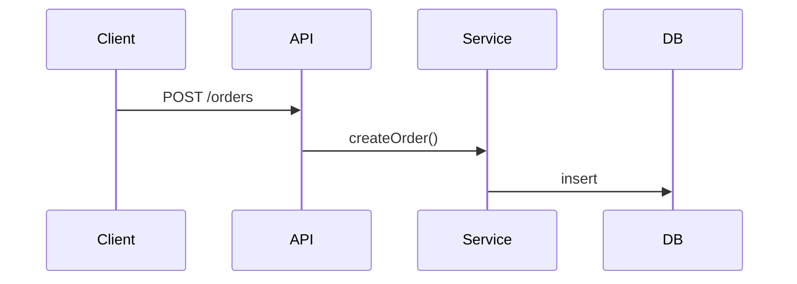

# Codebase Explainer

Turn "I just cloned this and I'm lost" into "I know where everything lives". The diagrams come from the imports in the code, not from guessing at folder names.

## 1. Map the imports

```bash
python3 scripts/code_map.py .                                    # modules, entry points, hubs, cycles, orphans, packages
python3 scripts/code_map.py . --format mermaid                   # module diagram, heaviest edges only
python3 scripts/code_map.py . --format mermaid --focus src/api   # file-level diagram of one folder
python3 scripts/code_map.py . --format html --out /tmp/code-map.html   # interactive graph, one offline file
python3 scripts/code_map.py . --format json                      # the full model, for your own queries
```

Options: `--depth N` (folder levels per module, picked automatically by default), `--exclude 'GLOB'` (repeatable, for fixtures, generated code and vendored copies), `--skip-tests`, `--max-nodes` and `--max-edges` for the diagram. Exit codes: `0` ok · `2` nothing to analyse.

It resolves Python imports (relative, `src/` layouts, `importlib.import_module("literal")`), JS/TS (`import`, `export … from`, `require`, `import()`, index files, `tsconfig`/`jsconfig` `paths`, workspace package names) and Go (through `go.mod`). Other languages get file and line counts but no edges.

| Section | What it means |
|---|---|
| Entry points | `__main__` guards, Go `package main`, package.json `bin`/`main`/scripts, pyproject scripts. "file name" alone is a guess |
| Hubs | files imported by 3 or more non-test files. A change here reaches all of them |
| Cycles | `import-time` cycles can break on load or change with import order. `lazy only` ones go through function-level, type-only or dynamic imports |
| Orphans | nothing imports them and they aren't entry points: dead code, or loaded in a way the parse can't see |
| Unresolved | local imports that point nowhere: stale paths or an alias it couldn't read |

**Limits:** a static parse can't see imports built from strings at runtime, DI containers, reflection, plugin registries, framework conventions (file-based routes, decorators) or calls between services over HTTP and queues. Say this in the guide. Don't present the graph as complete, and check the heaviest edges in the code before explaining them.

## 2. Read around the facts

Skim the README, manifests, CI workflows, Dockerfiles and env examples. Then open each real entry point and follow one request or command down through the hubs it reaches, and find the data layer (ORM models, migrations, API clients). For churn, run `git log --since=1.year --name-only --pretty=format: | sort | uniq -c | sort -rn | head -20`. A hub that also churns a lot is the riskiest file in the repo.

## 3. Write `ARCHITECTURE.md` (or show it inline if the user prefers)

````markdown
# Architecture of <project>

## TL;DR
3 sentences: what it does, main tech, how it's deployed.

## Map
| Path | Responsibility | Files | LOC |

## Components
```mermaid
flowchart LR
  %% from code_map.py --format mermaid; rename labels if you like, never add edges it didn't find
```

## How a request flows


## Key concepts & glossary
## Handle with care
| File | Why | Evidence |
e.g. `core/state.py` | everything reads it | imported by 23 files, in an import-time cycle with `core/events.py`, 41 commits this year

## Getting started
Run, test, debug commands (verified from the repo).

## Where to make common changes
"Add an API endpoint → ...", "Add a screen → ...", "Add a DB column → ..."

## What this map can't see
Which of the limits above apply here.
````

The sequence diagram comes from reading code, not from the script. If you draw a link the parse didn't find (an HTTP call, a queue), make it dashed and say where you saw it.

## 4. Offer the interactive map

Ask where to write `code-map.html` (outside the repo or a gitignored path, unless they want it committed). It's one file with no network requests: click a node to light up what it imports and what imports it, search by path, switch between modules and files, cycle edges in red. Repos over 800 files get the module view only (`--html-max-files` raises that).

## Rules

- Every claim points to real paths, and every number comes from the script's output.
- Diagrams must be valid Mermaid and stay small (about 25 nodes or fewer). Use several focused diagrams rather than one huge one.
- Explain *why* things are structured this way when the code or commit history shows it.
- List open questions you couldn't answer instead of making things up.
- Don't write files into the user's repo without asking.
